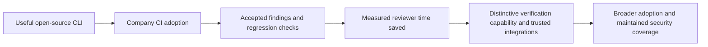
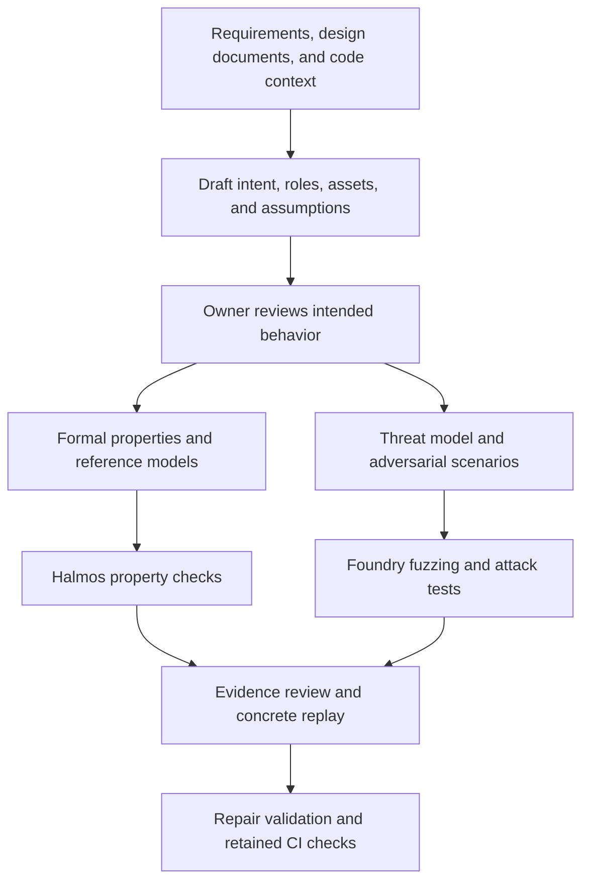

# Smart-contract security automation: master plan

Research date: 2026-10-07. Repository initialized: 2026-10-08. Status: proposed product and implementation plan; no product code or experiments have been run. This document describes the standalone Contract Security Agent project.

Accepted evaluation order: benchmark the system first, then investigate one current well-known protocol module. The initial external benchmark is SCONE-bench; historical exploit performance, formal-verification quality, and prospective findings receive separate scores.

Read alongside [tool research](TOOL_RESEARCH.md), [evaluation plan](EXPERIMENT_PLAN.md), and [experiment tracker](EXPERIMENT_TRACKER.md).

## 1. Decision

Build an open-source security CLI and GitHub Action for Solidity/Foundry repositories. It should translate reviewed protocol intent into formal properties, investigate code through adversarial tests, produce independently replayable evidence, validate repairs, and preserve accepted security properties as regression checks.

The first customer promise is: **“Turn your protocol's security requirements into continuously checked properties and reproducible attack tests.”** Position it as part of internal review and preparation for external audits. Whether it reduces external audit cost requires customer evidence.

The project aims to make rigorous security checks practical in everyday protocol development. The proposed path is:

Each milestone should demonstrate useful outcomes for developers and security reviewers.

## 2. Initial customer and scope

Target an engineering/security team actively changing an EVM protocol, already using Foundry and internal review, with a reviewer able to explain intended accounting and authorization behavior. Access to three such teams matters more initially than broad language coverage.

Start with **share, reward, and withdrawal accounting plus related authorization**. Choose the first module from a reachable partner's vault, staking system, or DEX liquidity module. This uses the founder's Coinbase, DEX, and staking experience while keeping one build environment and a tractable set of requirements. Prefer a real, frequently changing repository over an idealized protocol category.

Examples of properties to investigate, subject to each protocol's documented semantics:

- An account cannot claim another account's rewards or redeem its shares.
- Reward allocation agrees with a small independent accounting model across deposit, claim, and withdrawal sequences.
- Rounding cannot create an economically material entitlement through repeated operations under explicitly stated token and fee assumptions.
- Changing privileged parameters requires the intended role and delay.

Do not assume that share prices always increase, assets never decrease, or every token behaves like a standard ERC-20. Slashing, rebasing, fees, donations, losses, privileged operations, and external dependencies can change the correct property. Human review of requirements is part of the MVP.

Expand to DEX pricing/oracles and more complex multi-contract economics after the first workflow is retained. Tokenized securities can follow for on-chain transfer restrictions and administrative controls; legal compliance and off-chain identity correctness require additional evidence beyond contract analysis.

## 3. Intent is the shared starting point

Intent-to-formal-verification and adversarial threat testing are first-class workflows. A human-reviewed, versioned intent record connects them. The first supported deployment scope is contracts and protocol transactions; surrounding-application testing is a separate extension described in the tool research.

An intent record should contain: requirement ID, plain-language rule, source/owner, protected assets, actors and permissions, affected operations, allowed examples, forbidden examples, assumptions, and unresolved questions. The formal representation also identifies state variables/reference state, preconditions, postconditions/invariants, external-call models, and the selected verification scope.

Generate candidate intent from documentation, prior review findings, and code. Label code-derived descriptions as inferred until the owner confirms them. The implementation cannot be the sole authority on what it was supposed to do; otherwise the system can reproduce the same bug in its specification.

Example: **“A staker cannot claim the same accrued rewards twice.”** Refine what accrual means, how time changes, which tokens are supported, how funding works, and what happens during slashing or emergency withdrawal. An independent reference model tracks entitlement and cumulative payouts. Formal checks explore the supported transition model within explicit bounds; adversarial tests try repeated claims, intervening deposits/withdrawals, reentrancy where relevant, and rounding boundaries. The property must still permit legitimate new rewards to accrue.

Check specification quality before accepting a passing result: demonstrate reachable preconditions, execute legitimate examples, confirm forbidden examples fail, and test deliberately faulty implementations. Agreement between two tools using the same weak property does not validate the intended requirement. Maintain some expert-authored scenarios independently of the property generator.

The adversarial path also investigates threats missing from the current intent record. A new finding can reveal an omitted requirement; the owner reviews that proposed addition before it becomes an accepted property. This prevents both paths from inheriting the same blind spots.

Automate property generation, harness repair, solver feedback, counterexample minimization, and subsequent CI execution. Require review when meaning or assumptions change. Once accepted, a stable requirement should rerun without repeated human approval on every code change.

Halmos is the first formal backend because its Solidity/Foundry property format minimizes the first integration surface. Add a CVL/Certora or Kontrol backend when accepted requirements need proof scope or modeling capabilities beyond that first backend. Do not describe a bounded result as proof of an unrestricted protocol-level claim.

## 4. What the MVP does

The initial end-to-end workflow:

1. **Establish intent and a reproducible project snapshot.** Review a small set of security requirements. Record base/head/merge-candidate commits, native compiler settings, dependencies, and existing tests. Unsupported builds produce a diagnostic and incomplete status.
2. **Understand the change and threat model.** Use the diff to prioritize investigation; include callers, callees, inheritance, relevant storage, dependencies, deployment configuration, and design documents. Allow investigation beyond changed lines. Describe attacker capabilities and environmental assumptions explicitly.
3. **Generate formal properties and attack hypotheses.** Give the model reviewed intent, structured code context, and static signals. Require an affected requirement, preconditions, and a proposed validation method. Preserve open questions instead of silently guessing intended economics.
4. **Execute checks.** Generate Foundry tests and selected Halmos properties in designated harness files. Preserve application source. Apply finite budgets.
5. **Validate evidence independently.** Start from a fresh snapshot and trusted setup. Check whether the counterexample is feasible under the claimed attacker capabilities. Replay transaction-level exploit claims on fresh Anvil state where supported.
6. **Validate a proposed repair.** Freeze the safety regression and environment, run it against vulnerable and repaired snapshots, and rerun legitimate-behavior tests. A repair is a candidate until reviewed.
7. **Report and retain.** Publish a concise CI summary with JSON and reproduction artifacts. A maintainer can accept useful tests/properties into the repository for future changes.

Implement the first vertical slice with one reviewed intent, one generated formal property, one supplied attack scenario, independent replay, and repair validation. Add autonomous attack discovery once the evidence path is reliable. Both formal verification and adversarial testing belong in the pilot; the internal milestone limits automation breadth while validating their shared contract.

Proposed CLI operations, with the final command name still undecided: `doctor`, `intent`, `verify`, `attack-test`, `scan`, `reproduce`, `verify-fix`, `replay`, and `export`. Start with the smallest working command surface; the same implementation drives local use and CI.

### Two CI paths

**Routine PR path:** rerun accepted regressions and applicable properties, then run a budgeted advisory investigation of the change. Accepted deterministic regressions can become required checks according to customer policy. New AI findings remain advisory initially.

**Deeper path:** manually triggered or scheduled investigation with a larger budget, broader stateful fuzzing, and selected symbolic checks. Expensive discovery should not delay every ordinary development loop.

Bind each result to its exact code, intent, dependencies, settings, and tool versions. Changes to those inputs invalidate the corresponding cached verdict. Reusing a compiled artifact is separate from reusing an old security conclusion.

Provide Markdown and JSON from the first release. Add SARIF as an export; private/internal GitHub code-scanning integration depends on the organization's GitHub Code Security entitlement. [GitHub SARIF documentation](https://docs.github.com/en/code-security/how-tos/find-and-fix-code-vulnerabilities/integrate-with-existing-tools/upload-sarif-file)

## 5. Recommended stack

| Layer | MVP choice | Decision rationale |
|---|---|---|
| CLI and schemas | Python 3.12, Typer, Pydantic v2, `uv` | Small integration surface; aligns with Slither/Halmos ecosystem; validates artifact formats. |
| Workflow | Explicit checkpointed state machine; SQLite and JSONL events | Retries, cost, incomplete runs, and provenance remain inspectable. |
| Workflow reference | Selective adaptation of Anthropic's defending-code harness | Reuse discovery/verification/repair patterns; replace C/C++ detector and grading assumptions with Solidity-specific validation. |
| Model integration | Official Anthropic and OpenAI API SDK adapters | Compare providers on the same tasks; use one primary provider per run. |
| Build and concrete execution | Foundry: Forge, Anvil, Cast | Existing Solidity test format, fuzzing, invariant testing, trace and transaction replay. |
| Static analysis/context | Slither with crytic-compile | Established deterministic signals and program structure. |
| Formal verification | Halmos adapter over reviewed properties | Required MVP workflow; run only applicable properties with explicit bounds and assumptions. |
| Execution environment | Pinned OCI tool image, disposable VM, gVisor where validated | Isolate target code from the credential-holding controller. |
| Distribution | Python package, versioned tool image, thin GitHub Action | Local and CI execution share the same implementation. |
| Evaluation | Frozen real bug/fix pairs, controls, Gambit diagnostics | Measure useful evidence and repair discrimination. |

See [tool research](TOOL_RESEARCH.md) for licenses, source links, release candidates, and integration caveats. The recommended version combination still needs a compatibility spike. Python is a proposed productivity choice; a team with materially stronger TypeScript expertise can change it before implementation.

Defer a second fuzzer, custom prover, vector database, multi-agent framework, dashboard, hosted accounts, fine-tuning, and broad chain support. Add each only when observed failures justify it. A single discovery agent with bounded tool use and a separate validation stage is enough to test the product thesis; neither multiple models nor a large swarm is a default requirement.

## 6. What we must build ourselves

Existing tools provide execution and analysis. The product's own work is:

- Translating protocol intent into reviewable specifications, reference models, and concrete security claims; tracking their quality and change history.
- Preparing realistic, reproducible environments without silently introducing attacker privileges.
- Converting findings into frozen safety regressions and checking repairs without weakening those regressions.
- Keeping evidence, assumptions, versions, costs, and unresolved coverage attached to every result.
- Making accepted checks cheap to maintain across future changes.
- Measuring whether reviewers save time and keep the integration enabled.

LLM-generated specifications alone are already an existing capability: [Pashov's skills](https://github.com/pashov/skills) include audit and fuzzing workflows, and [Certora AutoProver](https://github.com/Certora/AutoProver) automates specification/harness work with prover feedback. Differentiation must be demonstrated against them and general coding agents.

Certora Prover itself is a formal-verification engine. Its CVL invariant workflow can establish an initial condition and preservation by contract methods, supporting inductive guarantees under sound modeling and assumptions. AutoProver supplies the separate AI automation layer. Halmos remains our initial bounded backend; a Certora integration serves selected stronger proof obligations. [Certora invariant semantics](https://docs.certora.com/en/latest/docs/cvl/invariants.html)

### Reusing Anthropic's defending-code harness

Use the [defending-code reference harness](https://github.com/anthropics/defending-code-reference-harness) as an upstream design and selective-code source for the adversarial workflow. Its current reference target is C/C++ memory safety and the repository is explicitly unmaintained. Pin an upstream revision and preserve its Apache-2.0 license and applicable notices for copied material. This plan authorizes research/design only; no upstream code has been incorporated yet.

| Upstream component or behavior | Our adaptation |
|---|---|
| Threat modeling and reconnaissance | Assets, roles, external calls, protocol state, dependencies, and reviewed intent |
| Discovery agents | Generate Solidity tests and transaction sequences against a fixed target snapshot |
| Fresh-environment grader | Rebuild the original snapshot and validate restricted transaction replay plus a protected outcome check |
| Deduplication and reporting | Group by requirement, affected transition, and underlying cause; preserve economically distinct outcomes |
| Patch grading | Keep the requirement and safety regression fixed; rerun legitimate behavior and adversarial checks |
| Sandboxing, transcripts, resumability | Adapt compatible isolation and artifact patterns; retain our credential separation and aggregate-budget policy |

The upstream customization guide identifies the finding/grading/report prompts, ASAN signatures, patch checks, and target build as porting points. A reverted Solidity transaction is often expected behavior, so it cannot substitute for an ASAN crash as the success signal. Conversely, a harmful accounting transaction may return successfully. Grade the violated requirement and demonstrated impact. [Customization guide](https://github.com/anthropics/defending-code-reference-harness/blob/main/docs/customizing.md)

Keep a stable internal evidence format and provider adapters. Start with one discovery worker and a separate validator; enable parallel discovery only after measuring value and resource use. Before selecting reusable implementation modules, complete a small port spike: one fixed Foundry target, one supplied PoC, fresh replay, duplicate handling, repair validation, and complete cost/artifact accounting. Selective adoption must not remove either the intent/formal workflow or the ability to evaluate another model provider.

The inspected upstream revision is `d3bea6b5793b5f3d59a75ebe69a58efa88383145`. Its runtime invokes Claude Code CLI, and fresh grading still produces a model-generated verdict. Our implementation keeps direct provider adapters and computes concrete execution verdicts through protected checkers. Preserve incomplete states when re-attack or regression checks do not finish. See the [source-level reuse analysis](TOOL_RESEARCH.md#defending-code-source-inspection-and-reuse-decision) for concrete modules, image/runtime coupling, and isolation differences.

### Evidence contract

Keep independent fields for the claim, execution, replay, human adjudication, and CI disposition. A solver result or test execution does not establish economic relevance by itself.

| Dimension | Example values |
|---|---|
| Claim kind | Bug hypothesis; intended property; repair claim |
| Engine outcome | Counterexample; tested without failure; holds within stated bounds; inconclusive; execution error |
| Independent validation | Not attempted; replayed; invalid setup; blocked by environment |
| Reviewer decision | Unreviewed; confirmed; rejected; needs more information |
| Lifecycle | New; accepted regression; waived with reason; fixed; regressed |

Every bundle records exact code/build/tool/model versions, prompt and harness hashes, requirements, assumptions, budgets, seeds, traces, and commands. Fork evidence also records chain ID, block number/hash, and external-state provenance. A confirmed issue can remain unreproduced when the environment is unsupported; preserve that distinction.

Halmos success means the selected property holds within documented bounds and assumptions unless completeness is separately established. Timeouts, skipped paths, unsupported operations, and all-paths-revert cases remain visible. Property edits that weaken assertions or add assumptions require review. See [Halmos configuration](https://github.com/a16z/halmos/blob/main/src/halmos/config.py) and [result handling](https://github.com/a16z/halmos/blob/main/src/halmos/__main__.py).

### Execution and trust boundary

Keep API credentials and publishing permissions in the controller/publisher. Build tools and generated tests run in disposable workers without those secrets, host Docker access, or unrestricted network access. Treat source comments, tool logs, dependencies, and model output as untrusted input.

For exploit replay, distinguish legitimate fixture funding from arbitrary balance/storage/role modifications that manufacture an attack. Use a restricted transaction replay interface and a protected outcome check. A fresh second agent is not sufficient independence.

Use trusted base-branch policy for budgets and command permissions. Fork PRs get deterministic checks without model secrets in the first version. Any later maintainer-triggered AI scan binds to an exact commit and still uses isolation. Never execute untrusted PR code through privileged `pull_request_target` workflows. [GitHub secure workflow guidance](https://docs.github.com/en/actions/reference/security/secure-use)

Validate the actual compiler, solver, filesystem, and fuzzing stack under gVisor before choosing it as a supported backend. If it is incompatible, use a disposable VM with equivalent credential/network separation; do not silently downgrade isolation. [gVisor architecture](https://gvisor.dev/docs/)

## 7. Ninety-day execution plan

Assumption: one full-time founder using AI implementation assistance, recurring access to experienced security reviewers, and access to pilot repositories. This is a sequencing proposal; staffing, reviewer availability, and runway have not been confirmed.

| Period | Deliverable | Proposed exit gate |
|---|---|---|
| Days 1–14 | One supported Foundry environment; harness-port and tool compatibility spikes; intent/evidence schemas; isolated runner; one intent → Halmos property plus adversarial test → repair check; eight reviewed examples | Another engineer can reproduce the result. Weak properties, invalid fixtures, incomplete checks, and broken repairs are exposed. |
| Days 15–30 | CLI; guided intent translation; attack-discovery loop; advisory CI; SCONE smoke test and frozen 20-task comparison; first formal/property-quality evaluation | Independent evidence and official benchmark grading agree. Report costs, failures, and leakage limits. Formal results retain separate metrics. |
| Days 31–60 | After the benchmark gate, investigate one current well-known protocol module on a local deployment/fork; three design-partner installations; prospective PR evaluation and retained checks | Candidate findings survive independent review; report negative results honestly. Partners rerun on new changes, review findings, and retain useful tests. |
| Days 61–90 | Repeatable release process; model comparison; selected deeper checks; quantified adoption and reviewer outcomes | Three organizations remain active across four eligible weeks; two document reviewer-time savings and retain generated regressions. These are planning targets, not market evidence. |

For the first fourteen days, prioritize: choose the partner module and intent statements; pin and exercise the toolchain; generate and review a meaningful property; test known allowed/forbidden behavior; validate a supplied attack; freeze the regression; reject an invalid repair; export a bundle; have another reviewer replay it. Build broader discovery after that vertical slice works.

The external evaluation sequence is SCONE smoke task → frozen 20-task pilot → repeated fixed comparison when justified → one current-protocol investigation. Compare against SCONE's reference agent with the same model and aggregate inference/execution limits. Use the official grader unchanged and keep benchmark outcomes separate from product-specific evidence grading. Pin the benchmark revision and record archive-RPC/source-fetch requirements. [SCONE setup and runner](https://github.com/anthropics/scone-bench)

Choose the current protocol module for source availability, reproducible dependencies, relevant accounting/authorization semantics, and a suitable disclosure channel. Pin both source revision and deployed fork state, including proxy implementation/configuration when applicable. Discovery runs locally against that snapshot. Independent review must distinguish a new issue from a known finding, an unrealistic environment, or intended privileged behavior; no validated finding is an acceptable recorded result.

If autonomous discovery underperforms while reviewed formal checks and supplied-scenario replay save time, retain that combined intent/verification workflow as the first useful product while improving discovery. A reproduction-only offering would be a separate product pivot requiring evidence. If even the narrower supported workflow needs bespoke founder work for every repository, reduce supported configurations before adding engines.

If surrounding-application penetration testing is confirmed as a priority, reserve a conditional days 61–90 pilot for one staging API authorization workflow. Its gate is a reproducible prohibited cross-account action, rejection of that action after repair, and continued success of legitimate same-account actions. Add a ZAP adapter only where useful for that target. This extension depends on the core workflow being stable and available engineering capacity; general web/application pentesting is not covered by the initial contract milestones.

## 8. Adoption plan and measurement

Offer a local CLI and bring-your-own-model-key CI setup. Start with personal introductions to teams where the founder understands the review process. The proposed design-partner request is access to one supported repository, one named reviewer, and four weeks of relevant changes. No outreach has been sent as part of this research.

The onboarding artifact should include a sample result, a complete reproduction bundle, one workflow file, an explicit support matrix, and a documented removal path. Target independent installation in under 30 minutes on the supported template; measure actual time before making this a promise.

Measure:

- **Eligible-repository retention:** relevant code changed, the workflow ran, a maintainer reviewed the evidence, and the integration stayed enabled across later weeks.
- Active expert minutes per reviewed issue/PR, including debugging and dismissed noise.
- Accepted findings, accepted regression checks, and later useful executions of those checks.
- Known in-scope issues missed, invalid evidence accepted, and checks left incomplete.
- Inference/compute cost per accepted result, onboarding time, and weekly founder support per repository.

Stars, downloads, and one successful demo are awareness signals. Repeated organizational use demonstrates sustained value in real development workflows.

Data sharing must be opt-in and specific: operational telemetry, benchmark redistribution, publication, and model training are different permissions. A CI installation does not grant ownership of private source or permission to train on customer traces. Self-hosted execution can still disclose selected code to the customer's chosen model API; document the actual data flow.

## 9. Roadmap beyond the MVP

Expand the project through demonstrated verification quality, maintainable integrations, and recurring use by protocol teams.

| Stage | Capability to develop | Evidence of progress |
|---|---|---|
| MVP | Reviewed intent → formal/adversarial checks → evidence → regression workflow | Meaningful specifications; independent replay; correct repair discrimination; cost and failure breakdown |
| Repeat adoption | Workflow used by security and protocol teams | Retained active repositories, accepted artifacts, measured reviewer savings |
| Technical distinction | Better specification/evidence quality on difficult accounting and stateful cases | Equal-budget wins over strong current agents; ablations; prospective cases |
| Interoperability | Reusable provider, verifier, and CI integrations | Reproducible runs across supported configurations and documented integration contracts |
| Sustainable maintenance | Contribution process, release discipline, and clear dependency/data provenance | Reliable updates, reviewed contributions, explicit data rights, and documented compatibility |

Use post-MVP effort approximately as a working allocation: 60% customer workflow and reliability, 25% verification/evaluation, and 15% documentation, reproducible research, and contributor support. Adjust to actual bottlenecks. This is a proposed allocation, not a staffing estimate.

Publish reproducible findings, benchmark limitations, and integration examples when disclosure and data permissions allow. Use feedback from maintainers, auditors, and protocol teams to prioritize supported properties and execution environments.

## 10. Decision gates and scope discipline

- If new model releases erase the improvement over a straightforward agent, redirect effort toward evidence validation, accepted properties, and integration value; remeasure rather than preserving an obsolete orchestration scheme.
- If pilots lack enough relevant changes, recruit more active teams before interpreting inactivity as retention or churn.
- If low-noise, reviewed evidence does not save time, revise the product promise and supported tasks before expanding distribution.
- Add Echidna/Medusa only when a measured stateful-coverage gap warrants another adapter. Add Certora/Kontrol when important accepted properties exceed the selected bounded approach.
- Expand chain/framework support when retained users request it and the compatibility cost is understood.
- Avoid a custom model or GPU training dependency until inference costs or controlled evaluations establish a specific need.

The next concrete milestone is a small demonstration on a real accounting change: formalize the intended requirement, exercise it through symbolic checks and adversarial scenarios, independently reproduce a failure, validate a repair against frozen checks, and retain those checks in CI. The [evaluation plan](EXPERIMENT_PLAN.md) defines what would justify progressing beyond it.
