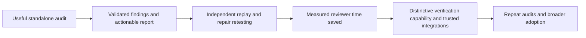
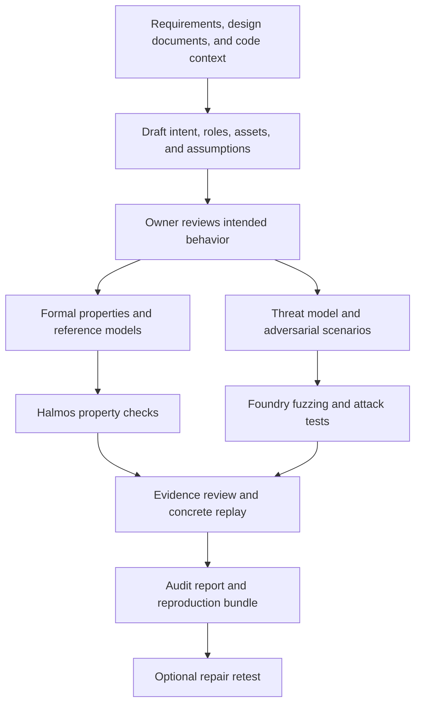

# Smart-contract security automation: master plan

Research date: 2026-10-07. Repository initialized: 2026-10-08. Status: proposed product and implementation plan; no product code or experiments have been run. This document describes the standalone Contract Security Agent project.

Scope decision, 2026-10-18: the MVP is a standalone, end-to-end smart contract security audit system. CI integration and continuous regression workflows are post-MVP extensions. This scope update does not refresh the dated tool research or claim implementation progress.

Delivery constraint: **finish the MVP within seven days with one SDE and multiple AI implementation agents.** The seven-step audit workflow in section 4 is agreed scope. Reduce supported configurations and defer research breadth to meet the deadline; preserve each workflow capability. Day 1 means the start of implementation, with release due by the end of day 7.

Release goal: publish an open-source project that smart contract teams can immediately install and use to audit their own supported repositories. A demonstration fixture establishes correctness; the product must accept other compatible projects through ordinary configuration, with no product-code changes or founder-authored setup for each target.

Accepted evaluation order: benchmark the system first, then investigate one current well-known protocol module. The initial external benchmark is SCONE-bench; historical exploit performance, formal-verification quality, and prospective findings receive separate scores.

Read alongside [tool research](TOOL_RESEARCH.md), [evaluation plan](EXPERIMENT_PLAN.md), and [experiment tracker](EXPERIMENT_TRACKER.md).

## 1. Decision

Build an open-source smart contract security audit system, initially delivered through a CLI for Solidity/Foundry repositories. It should understand the selected protocol scope, discover vulnerabilities through code analysis and adversarial investigation, check reviewed security requirements, independently validate evidence, and deliver an actionable audit report. Support retesting when a proposed repair is supplied.

The first customer promise is: **“Audit your smart contracts and get actionable findings backed by reproducible evidence.”** Reports must make the reviewed scope, assumptions, analysis coverage, and unresolved risks explicit. Whether it reduces expert effort or external audit cost requires customer evidence.

The project aims to make rigorous security audits practical for protocol teams and auditors. The proposed path is:

Each milestone should demonstrate useful outcomes for developers and security reviewers.

## 2. Initial customer and scope

Target protocol engineering/security teams and auditors reviewing an EVM codebase, already using Foundry, with a reviewer able to explain intended accounting and authorization behavior. Access to three such teams matters more initially than broad language coverage. A complete selected snapshot is the default audit target; a code change may inform priorities but is not required.

Start with **share, reward, and withdrawal accounting plus related authorization**. Pin one Foundry compatibility baseline and a representative acceptance module on day 1, preferably from a reachable partner's vault, staking system, or DEX liquidity module. Have a reproducible fixture available immediately so partner access does not delay delivery. The baseline describes supported compiler/dependency/layout constraints; it must accept a team's own compatible repository and selected scope. This uses the founder's Coinbase, DEX, and staking experience while keeping one build environment and a tractable set of requirements. Validating every protocol category is not a day-7 requirement.

Examples of properties to investigate, subject to each protocol's documented semantics:

- An account cannot claim another account's rewards or redeem its shares.
- Reward allocation agrees with a small independent accounting model across deposit, claim, and withdrawal sequences.
- Rounding cannot create an economically material entitlement through repeated operations under explicitly stated token and fee assumptions.
- Changing privileged parameters requires the intended role and delay.

Do not assume that share prices always increase, assets never decrease, or every token behaves like a standard ERC-20. Slashing, rebasing, fees, donations, losses, privileged operations, and external dependencies can change the correct property. Human review of requirements is part of the MVP.

Expand to DEX pricing/oracles and more complex multi-contract economics after the first audit workflow demonstrates useful results. Tokenized securities can follow for on-chain transfer restrictions and administrative controls; legal compliance and off-chain identity correctness require additional evidence beyond contract analysis.

## 3. Intent is the shared starting point

Intent-to-formal-verification and adversarial threat testing are first-class workflows. A human-reviewed, versioned intent record connects them. The first supported deployment scope is contracts and protocol transactions; surrounding-application testing is a separate extension described in the tool research.

An intent record should contain: requirement ID, plain-language rule, source/owner, protected assets, actors and permissions, affected operations, allowed examples, forbidden examples, assumptions, and unresolved questions. The formal representation also identifies state variables/reference state, preconditions, postconditions/invariants, external-call models, and the selected verification scope.

Generate candidate intent from documentation, prior review findings, and code. Label code-derived descriptions as inferred until the owner confirms them. The implementation cannot be the sole authority on what it was supposed to do; otherwise the system can reproduce the same bug in its specification.

Example: **“A staker cannot claim the same accrued rewards twice.”** Refine what accrual means, how time changes, which tokens are supported, how funding works, and what happens during slashing or emergency withdrawal. An independent reference model tracks entitlement and cumulative payouts. Formal checks explore the supported transition model within explicit bounds; adversarial tests try repeated claims, intervening deposits/withdrawals, reentrancy where relevant, and rounding boundaries. The property must still permit legitimate new rewards to accrue.

Check specification quality before accepting a passing result: demonstrate reachable preconditions, execute legitimate examples, confirm forbidden examples fail, and test deliberately faulty implementations. Agreement between two tools using the same weak property does not validate the intended requirement. Maintain some expert-authored scenarios independently of the property generator.

The adversarial path also investigates threats missing from the current intent record. A new finding can reveal an omitted requirement; the owner reviews that proposed addition before it becomes an accepted property. This prevents both paths from inheriting the same blind spots. Intake and discovery can proceed with explicitly recorded uncertainties; lack of a complete intent packet must not silently exclude code from the audit. Unconfirmed assumptions constrain the resulting claims.

Automate property generation, harness repair, solver feedback, counterexample minimization, and audit execution within finite budgets. Require review when meaning or assumptions change. Export accepted properties and tests for reproduction and repair retesting; continuous execution on future code changes is a later integration.

Halmos is the first formal backend because its Solidity/Foundry property format minimizes the first integration surface. Add a CVL/Certora or Kontrol backend when accepted requirements need proof scope or modeling capabilities beyond that first backend. Do not describe a bounded result as proof of an unrestricted protocol-level claim.

## 4. What the MVP does

The initial end-to-end workflow:

1. **Scope the audit and capture a reproducible snapshot.** Accept a repository or local project, pin its revision, and enumerate included contracts, exclusions, compiler settings, dependencies, deployment configuration, and existing tests. Record the audit goals and budget. Unsupported builds produce a diagnostic and incomplete status.
2. **Understand the protocol and threat model.** Map entry points, callers/callees, inheritance, storage, assets, roles, trust boundaries, external dependencies, and intended accounting behavior. Identify relevant authorization, upgrade, callback, token, and lifecycle assumptions. A supplied diff is optional context; investigate the whole selected scope.
3. **Analyze code and develop security claims.** Combine Slither signals, structured code reasoning, reviewed requirements, and independent attack hypotheses. Investigate business logic and multi-call interactions as well as known patterns. Require an affected asset or requirement, preconditions, and a proposed validation method for each candidate. Preserve open questions instead of guessing intended economics.
4. **Execute adversarial and formal checks.** Generate Foundry scenario tests, stateful fuzzing harnesses, and selected Halmos properties in designated harness files. Preserve application source. Apply finite budgets and record exercised transitions and verification bounds.
5. **Validate and triage evidence independently.** Start from a fresh snapshot and trusted setup. Check whether the counterexample is feasible under the claimed attacker capabilities. Replay transaction-level exploit claims on fresh Anvil state where supported. Deduplicate findings and distinguish hypotheses, validated outcomes, and reviewer decisions.
6. **Deliver the audit report and evidence bundle.** Export Markdown and JSON with an executive summary, scope and methodology, findings by severity, affected code, root cause, realistic impact, preconditions, evidence, and remediation guidance. Include contract/requirement coverage, incomplete checks, assumptions, unresolved questions, and reproduction commands. Produce a report even when no finding is validated; absence of a finding is not a claim that the contracts are secure.
7. **Retest a supplied repair.** When a fix is available, freeze the requirement, safety regression, and environment; run checks against vulnerable and repaired snapshots and rerun legitimate-behavior tests. Export the retest outcome separately from the initial report. An initial audit does not require an available repair, and a repair remains a candidate until reviewed.

Implement the first vertical slice with a scoped project snapshot, one reviewed intent, one generated formal property, one supplied attack scenario, independent replay, an audit report, and repair validation. Add autonomous attack discovery once the evidence path is reliable. Both formal verification and adversarial testing belong in the pilot; the internal milestone limits automation breadth while validating their shared contract. The MVP exit gate also requires autonomous investigation across the selected module, an explicit coverage record, and severity/remediation reporting.

Week-one CLI operations, with the final executable name still undecided: `audit` as the primary entry point, plus `reproduce` and `verify-fix`. Run environment diagnostics during intake and export the report/bundle as part of `audit`; separate `doctor` and `export` commands can follow later. Intent analysis, static analysis, fuzzing, and formal checks are stages of an audit. Runs are manually initiated, with file-based checkpoints for completed stages.

### MVP boundary and completion

The MVP delivers a complete audit workflow for the supported Solidity/Foundry scope. It includes protocol understanding, vulnerability discovery, formal and adversarial checks, independent evidence validation, reporting, and supplied-fix retesting. It does not imply exhaustive vulnerability detection or support for every protocol and chain.

Defer GitHub Actions, PR comments and required checks, CI credentials/events, automated regression scheduling, and SARIF/code-scanning integration until after the MVP. Exported tests and properties remain useful audit artifacts without requiring a CI installation. Later integrations should reuse the audit engine and evidence contract.

Completion means a team can install the public release, run an audit on its own supported snapshot/configuration, inspect its coverage and limitations, independently reproduce validated findings, and retest an available fix without developer assistance. Normal scope configuration and requirement review remain part of the workflow. The seven-day release gate below defines the required evidence. Broader quality, customer savings, and repeat adoption require post-release evaluation.

Bind each result to its exact code, intent, dependencies, settings, and tool versions. Changes to those inputs invalidate the corresponding cached verdict. Reusing a compiled artifact is separate from reusing an old security conclusion.

Provide Markdown, JSON, and reproduction bundles from the first release. Use a documented severity rubric based on demonstrated impact, exploit preconditions, and affected assets; keep severity separate from evidence status. Every report must identify reviewed contracts and requirements, analysis performed, and work left incomplete or outside scope.

## 5. Recommended stack

| Layer | MVP choice | Decision rationale |
|---|---|---|
| CLI and schemas | Python 3.12, Typer, Pydantic v2, `uv` | Small integration surface; aligns with Slither/Halmos ecosystem; validates artifact formats. |
| Workflow | Explicit sequential stages; local JSON manifest/checkpoints and JSONL events | Inspect budgets, incomplete runs, and provenance without building a database or scheduler. |
| Workflow reference | Discovery/verification/repair patterns from Anthropic's defending-code harness | Use existing ideas; a substantial upstream port is outside the week-one critical path. |
| Model integration | One official API SDK and one configured model, selected on day 1 | One working provider path for delivery; keep schemas independent so a second adapter can follow later. |
| Build and concrete execution | Foundry: Forge, Anvil, Cast | Existing Solidity test format, fuzzing, invariant testing, trace and transaction replay. |
| Static analysis/context | Slither with crytic-compile | Established deterministic signals and program structure. |
| Formal verification | Halmos adapter over reviewed properties | Required MVP workflow; run only applicable properties with explicit bounds and assumptions. |
| Execution environment | Pinned OCI tool image in a disposable VM, separate from the controller | Validate one isolation setup; keep gVisor compatibility research outside the release path. |
| Distribution and reporting | Python package, versioned tool image, Markdown/JSON and reproduction bundles | A standalone audit can be run, reviewed, and reproduced without service integration. |
| Release validation | One pinned bug/fix fixture, legitimate-behavior controls, critical evidence-integrity cases, a meaningful reviewed property, and a separate compatible repository | Establish workflow correctness, repair discrimination, and independent onboarding by day 7; broader benchmark and mutation studies follow release. |

See [tool research](TOOL_RESEARCH.md) for licenses, source links, release candidates, and integration caveats. Pin and validate the Python/Foundry/Slither/Halmos combination on day 1. If the selected target cannot build within that timebox, choose a simpler supported fixture before freezing the configuration; architecture and language exploration must not consume the delivery week.

Defer CI integration, a second provider/fuzzer, custom prover, database-backed orchestration, vector database, multi-agent runtime framework, dashboard, hosted accounts, fine-tuning, and broad chain support. Add each only when observed failures justify it. Multiple AI agents build the product in parallel; the week-one product runtime uses one budgeted discovery loop and a separate validation stage.

## 6. What we must build ourselves

Existing tools provide execution and analysis. The product's own work is:

- Turning the selected codebase into a protocol map, threat model, and reviewable audit scope with explicit coverage gaps.
- Translating protocol intent into reviewable specifications, reference models, and concrete security claims; tracking their quality and change history.
- Preparing realistic, reproducible environments without silently introducing attacker privileges.
- Converting findings into frozen safety regressions and checking repairs without weakening those regressions.
- Keeping evidence, assumptions, versions, costs, and unresolved coverage attached to every result.
- Producing a deduplicated audit report with justified severity, realistic impact, and actionable remediation.
- Making accepted evidence easy to reproduce and reuse when retesting repairs.
- Measuring whether reviewers save time and choose the system for subsequent audits.

LLM-generated specifications alone are already an existing capability: [Pashov's skills](https://github.com/pashov/skills) include audit and fuzzing workflows, and [Certora AutoProver](https://github.com/Certora/AutoProver) automates specification/harness work with prover feedback. Differentiation must be demonstrated against them and general coding agents.

Certora Prover itself is a formal-verification engine. Its CVL invariant workflow can establish an initial condition and preservation by contract methods, supporting inductive guarantees under sound modeling and assumptions. AutoProver supplies the separate AI automation layer. Halmos remains our initial bounded backend; a Certora integration serves selected stronger proof obligations. [Certora invariant semantics](https://docs.certora.com/en/latest/docs/cvl/invariants.html)

### Reusing Anthropic's defending-code harness

Use the [defending-code reference harness](https://github.com/anthropics/defending-code-reference-harness) as a design reference for the adversarial workflow. Its current reference target is C/C++ memory safety and the repository is explicitly unmaintained. Selective code reuse is optional after delivery; pin the upstream revision and preserve its Apache-2.0 license and applicable notices for any copied material. No upstream code has been incorporated yet.

| Upstream component or behavior | Our adaptation |
|---|---|
| Threat modeling and reconnaissance | Assets, roles, external calls, protocol state, dependencies, and reviewed intent |
| Discovery agents | Generate Solidity tests and transaction sequences against a fixed target snapshot |
| Fresh-environment grader | Rebuild the original snapshot and validate restricted transaction replay plus a protected outcome check |
| Deduplication and reporting | Group by requirement, affected transition, and underlying cause; preserve economically distinct outcomes |
| Patch grading | Keep the requirement and safety regression fixed; rerun legitimate behavior and adversarial checks |
| Sandboxing, transcripts, resumability | Adapt compatible isolation and artifact patterns; retain our credential separation and aggregate-budget policy |

The upstream customization guide identifies the finding/grading/report prompts, ASAN signatures, patch checks, and target build as porting points. A reverted Solidity transaction is often expected behavior, so it cannot substitute for an ASAN crash as the success signal. Conversely, a harmful accounting transaction may return successfully. Grade the violated requirement and demonstrated impact. [Customization guide](https://github.com/anthropics/defending-code-reference-harness/blob/main/docs/customizing.md)

Keep a stable internal evidence format and one provider implementation. Start with one discovery worker and a separate validator; enable parallel discovery only after measuring value and resource use. Exercise one fixed Foundry target, one supplied PoC, fresh replay, duplicate handling, repair validation, and cost/artifact accounting through the minimal runner. A later upstream port must preserve that contract and justify its integration cost; it is not a prerequisite for the release. Preserve the intent/formal workflow and the ability to add another model provider later.

The inspected upstream revision is `d3bea6b5793b5f3d59a75ebe69a58efa88383145`. Its runtime invokes Claude Code CLI, and fresh grading still produces a model-generated verdict. Our implementation keeps direct provider adapters and computes concrete execution verdicts through protected checkers. Preserve incomplete states when re-attack or regression checks do not finish. See the [source-level reuse analysis](TOOL_RESEARCH.md#defending-code-source-inspection-and-reuse-decision) for concrete modules, image/runtime coupling, and isolation differences.

### Evidence contract

Keep independent fields for the claim, execution, replay, human adjudication, severity, and remediation status. A solver result or test execution does not establish economic relevance by itself.

| Dimension | Example values |
|---|---|
| Claim kind | Bug hypothesis; intended property; repair claim |
| Engine outcome | Counterexample; tested without failure; holds within stated bounds; inconclusive; execution error |
| Independent validation | Not attempted; replayed; invalid setup; blocked by environment |
| Reviewer decision | Unreviewed; confirmed; rejected; needs more information |
| Severity assessment | Impact; affected assets; preconditions; rubric and rationale |
| Lifecycle | New; open; remediation proposed; retest pending; fixed; accepted risk with reason |

Every bundle records exact code/build/tool/model versions, prompt and harness hashes, requirements, assumptions, budgets, seeds, traces, and commands. Fork evidence also records chain ID, block number/hash, and external-state provenance. A confirmed issue can remain unreproduced when the environment is unsupported; preserve that distinction.

Halmos success means the selected property holds within documented bounds and assumptions unless completeness is separately established. Timeouts, skipped paths, unsupported operations, and all-paths-revert cases remain visible. Property edits that weaken assertions or add assumptions require review. See [Halmos configuration](https://github.com/a16z/halmos/blob/main/src/halmos/config.py) and [result handling](https://github.com/a16z/halmos/blob/main/src/halmos/__main__.py).

### Execution and trust boundary

Keep API credentials in the controller. Build tools and generated tests run in disposable workers without those secrets, host Docker access, or unrestricted network access. Treat source comments, tool logs, dependencies, and model output as untrusted input. The report exporter validates artifact schemas, sizes, paths, and snapshot binding before rendering results; it must not execute artifact content.

For exploit replay, distinguish legitimate fixture funding from arbitrary balance/storage/role modifications that manufacture an attack. Use a restricted transaction replay interface and a protected outcome check. A fresh second agent is not sufficient independence.

Load budgets and command permissions from operator-controlled configuration outside the audited repository. Audited source cannot grant itself additional capabilities. Dependency retrieval and any fork RPC access are explicit, restricted phases; bind each run to its exact source and environment.

Validate the actual compiler, solver, filesystem, and fuzzing stack in the pinned tool image and disposable VM on day 1. gVisor can be evaluated after delivery and must pass compatibility checks before becoming a supported alternative. Preserve equivalent credential/network separation across execution backends. [gVisor architecture](https://gvisor.dev/docs/)

## 7. Seven-day delivery plan

The deadline is the end of day 7 from implementation kickoff. Staffing is **one full-time SDE plus multiple AI implementation agents**, with three concurrent agent workstreams. The SDE owns architecture, scope decisions, protected outcome checks, integration, review, and release acceptance. AI agents implement bounded tasks against shared interfaces and integrate daily; their output still requires review.

Freeze the support matrix on day 1: one pinned Foundry environment/compiler and documented repository layout/dependency constraints, one model provider, one isolated execution setup, and Markdown/JSON outputs. Select a representative accounting/authorization module for correctness tests and a separate compatible repository for onboarding validation. The audit engine accepts user-supplied compatible targets; fixture paths or known findings must not be embedded in its behavior. Keep all seven agreed workflow stages. Additional environments, engines, integrations, and research datasets go to the post-release backlog.

| Workstream | Ownership | Main dependency |
|---|---|---|
| AI agent A: tool execution | Tool image; build/intake diagnostics; Slither, Forge, Anvil, and Halmos subprocess adapters; resource limits and immutable target handling | SDE-approved environment and artifact schemas |
| AI agent B: audit reasoning | Protocol/threat mapping; requirement and candidate schemas; one provider integration; bounded discovery and harness/property generation | Shared schemas and stable tool adapter contract |
| AI agent C: evidence and delivery | Fresh replay; supplied-fix retest; deduplication; report/bundle exporter; release fixtures, quickstart, and independent-onboarding checks | Candidate/evidence schemas and SDE-owned protected outcome checks |
| SDE: integration and acceptance | Shared interfaces; isolation and credential boundary; frozen validation assertions; daily integrated runs; code review and release | Small, reviewable changes from all three agents |

| Day | Integrated deliverable | Exit check |
|---|---|---|
| 1 | Freeze schemas/support matrix; pin and exercise tools, provider, and isolated runner; select vulnerable/fixed fixture and separate compatible target; CLI/report skeleton | Both projects build through ordinary configuration; one run manifest binds source and environment; workers cannot access model credentials; tool limits and failure states are defined. |
| 2 | Intake, scope manifest, protocol/threat map, requirement review, and Slither adapter | `audit` produces a structured assessment of the whole selected scope and preserves unknown assumptions. |
| 3 | Bounded autonomous discovery loop, generated Forge scenario/fuzz harnesses, and one meaningful Halmos property | Execute actual adversarial/formal checks; distinguish counterexamples, tested paths, bounded holds, unsupported cases, and timeouts. |
| 4 | Fresh evidence replay, protected outcome validation, and supplied-fix retesting | Reproduce a fixture failure, reject invalid setup, distinguish vulnerable/fixed versions without changing the requirement, and preserve legitimate behavior. |
| 5 | Complete `audit` → Markdown/JSON report and reproduction bundle, plus `reproduce` and `verify-fix` | End-to-end workflow works on configured targets without product-code edits; report severity, remediation, scope/coverage, costs, and incomplete work, including no-finding runs. Feature freeze. |
| 6 | Integrated acceptance checks, quickstart/sample configuration, clean-install audit of the separate repository, cleanup/isolation review, and release candidate | An operator or fresh AI reviewer follows only the release documentation; no unpublished setup or developer intervention. Fix integration defects. Attempt external SCONE smoke only if access and budget are available. |
| 7 | Final SDE review, repeat the documented audit/replay/retest, publish the open-source release and sample artifacts | Installation and usage instructions match the published source/version; a team can configure and audit its own compatible target, inspect evidence, and retest a supplied fix. |

The critical path is pinned tools/isolation and schemas → discovery/check execution → independent replay and repair discrimination → complete report → fresh-install acceptance. Use deterministic candidate fixtures to integrate validation/reporting before live discovery is ready. End each day with one integrated run. Days 6–7 are reserved for fixes, documentation, and delivery.

### Day-7 release criteria

- Run a real model-backed audit of the selected scope through all agreed stages using the documented CLI and configuration. Candidate generation must operate without receiving the fixture's exploit or repair; score autonomous discovery separately from supplied-PoC reproduction.
- From a clean installation, audit a separate compatible repository using only the public quickstart, ordinary configuration, and a user-supplied API key. No source edits to the audit system, hardcoded fixture assumptions, bespoke integration code, or founder intervention. A no-validated-finding report is valid for this portability check; it does not establish detection quality.
- Export a protocol/threat map, reviewed requirement/assumption record, analysis coverage, and Markdown/JSON findings report with severity rationale, root cause, preconditions, impact, remediation, and reproducible evidence.
- Exercise Slither, Foundry scenario/stateful checks, and at least one reviewed, non-vacuous bounded Halmos property. Record allowed/forbidden behavior and the exact property scope; no general proof claim is implied.
- Independently reproduce at least one concrete failure from fresh state against the vulnerable fixture. The replay checker uses frozen assertions and verifies source/environment integrity. Reject fabricated privileges/state and malformed evidence.
- Retest a supplied repair against the unchanged safety check; confirm legitimate operations still work and reject an invalid repair. An ordinary audit can finish before a fix exists.
- Produce a useful report for no-validated-finding, unsupported-build, tool-failure, and exhausted-budget outcomes. Incomplete work never becomes a clean verdict. Bind artifacts to exact source/tool/model/configuration inputs and enforce finite execution/model limits.
- Publish versioned source under Apache-2.0 for the original core, dependency/license notices, an installable CLI with pinned dependencies/tool environment, a quickstart, a sample scope/budget configuration, a sample report/bundle, and audit/replay/retest/cleanup instructions. Document supported compiler/layout/dependency constraints, actual model data flow and key configuration, analysis limitations, and issue reporting. A hosted service account is not required. The SDE signs off on the integrated release.

These are required completion checks, not completed results. The one-week implementation demonstrates a functioning supported audit system. Broad vulnerability coverage, equal-budget superiority, and customer time savings remain claims for later experiments. If discovery only replays supplied examples, the discovery requirement remains unfinished; report the gap rather than treating a reproduction-only tool as the agreed MVP.

The separate-repository check establishes installation and target portability. It is not the later campaign to search a current well-known protocol for novel findings, and it does not change the external benchmark sequence.

### Evaluation after delivery

The external evaluation sequence remains SCONE smoke task → frozen 20-task pilot → repeated fixed comparison when justified → one current-protocol investigation. An access-blocked SCONE smoke is recorded as blocked; the 20-task comparison, 24-case product study, current-protocol campaign, and customer pilots are outside the seven-day release gate. Compare against SCONE's reference agent with the same model and aggregate inference/execution limits. Use the official grader unchanged and keep benchmark outcomes separate from product-specific evidence grading. Pin the benchmark revision and record archive-RPC/source-fetch requirements. [SCONE setup and runner](https://github.com/anthropics/scone-bench)

Choose the current protocol module for source availability, reproducible dependencies, relevant accounting/authorization semantics, and a suitable disclosure channel. Pin both source revision and deployed fork state, including proxy implementation/configuration when applicable. Discovery runs locally against that snapshot. Independent review must distinguish a new issue from a known finding, an unrealistic environment, or intended privileged behavior; no validated finding is an acceptable recorded result.

After release, if autonomous discovery underperforms on broader tasks while reviewed formal checks and supplied-scenario replay save time, prioritize discovery improvements within the supported audit workflow. A reproduction-only offering would be a separate product pivot requiring evidence. If even the narrower supported workflow needs bespoke founder work for every repository, reduce supported configurations before adding engines.

Any surrounding-application penetration-testing pilot is a post-MVP extension. If confirmed as a priority after the contract audit workflow is stable and capacity is available, start with one staging API authorization workflow. Its gate is a reproducible prohibited cross-account action, rejection of that action after repair, and continued success of legitimate same-account actions. Add a ZAP adapter only where useful for that target; general web/application pentesting is outside the contract audit MVP.

## 8. Adoption plan and measurement

This is post-release customer validation; completing partner studies is outside the seven-day delivery gate.

The day-7 open-source release must already be usable through its public quickstart and bring-your-own-model-key execution. Subsequent adoption work starts with personal introductions to protocol teams and auditors where the founder understands the review process. The proposed design-partner request is one supported repository/module at a pinned revision, relevant design/deployment context, and one named reviewer for an audit and available repair retests. No outreach has been sent as part of this research.

The onboarding artifact should include a sample audit report, a complete reproduction bundle, an audit configuration with scope and budget, an explicit support matrix, and a documented removal path. Target independent installation in under 30 minutes on the supported template; measure actual time before making this a promise.

Measure:

- **Audit completion and repeat use:** a supported scoped audit finishes with a usable report, a reviewer assesses the evidence, and the team chooses a subsequent audit or repair retest when needed.
- Active expert minutes per audit and reviewed issue, including setup, debugging, report review, and dismissed noise.
- Accepted findings, useful remediation recommendations, independently reproduced evidence, and correctly discriminated repairs.
- Known in-scope issues missed, invalid evidence accepted, and checks left incomplete.
- Inference/compute cost per audit and accepted result, onboarding time, and founder support per audit.

Stars, downloads, and one successful demo are awareness signals. Completed useful audits and subsequent organizational use demonstrate sustained value.

Data sharing must be opt-in and specific: operational telemetry, benchmark redistribution, publication, and model training are different permissions. Running an audit does not grant ownership of private source or permission to train on customer traces. Self-hosted execution can still disclose selected code to the customer's chosen model API; document the actual data flow.

## 9. Roadmap beyond the MVP

Expand the project through demonstrated verification quality, maintainable integrations, and recurring use by protocol teams.

| Stage | Capability to develop | Evidence of progress |
|---|---|---|
| MVP, by day 7 | Scope → protocol understanding → analysis/discovery → validated evidence → audit report, with supplied-fix retesting, on one supported configuration | All day-7 release criteria pass; inspectable artifacts and documented limitations |
| Repeat adoption | Repeat audits and retests used by auditors and protocol teams | Completed audits, accepted artifacts, subsequent use, measured reviewer savings |
| Technical distinction | Better specification/evidence quality on difficult accounting and stateful cases | Equal-budget wins over strong current agents; ablations; prospective cases |
| Continuous assurance, post-MVP | GitHub Actions, PR integration, retained regression checks, scheduled deeper audits, and SARIF export | Useful accepted checks rerun reliably; maintainers choose the integration after the audit workflow proves valuable |
| Interoperability | Reusable provider and verifier integrations | Reproducible runs across supported configurations and documented integration contracts |
| Sustainable maintenance | Contribution process, release discipline, and clear dependency/data provenance | Reliable updates, reviewed contributions, explicit data rights, and documented compatibility |

Sequence post-MVP work from measured failures, available engineering capacity, and customer needs. The follow-on roadmap does not extend the seven-day MVP deadline.

Publish reproducible findings, benchmark limitations, and integration examples when disclosure and data permissions allow. Use feedback from maintainers, auditors, and protocol teams to prioritize supported properties and execution environments.

## 10. Decision gates and scope discipline

- If new model releases erase the improvement over a straightforward agent, redirect effort toward evidence validation, accepted properties, and integration value; remeasure rather than preserving an obsolete orchestration scheme.
- If pilots lack a real audit or retest need, recruit teams with an upcoming review before interpreting inactivity as product rejection.
- If low-noise, reviewed evidence does not save time, revise the product promise and supported tasks before expanding distribution.
- Add Echidna/Medusa only when a measured stateful-coverage gap warrants another adapter. Add Certora/Kontrol when important accepted properties exceed the selected bounded approach.
- Expand chain/framework support when retained users request it and the compatibility cost is understood.
- Avoid a custom model or GPU training dependency until inference costs or controlled evaluations establish a specific need.

The immediate milestone is day-1 environment/schema freeze, followed by a complete standalone audit and day-7 release acceptance on the supported accounting/authorization module. Preserve the agreed end-to-end workflow; use the [evaluation plan](EXPERIMENT_PLAN.md) to distinguish release checks from post-release research.
